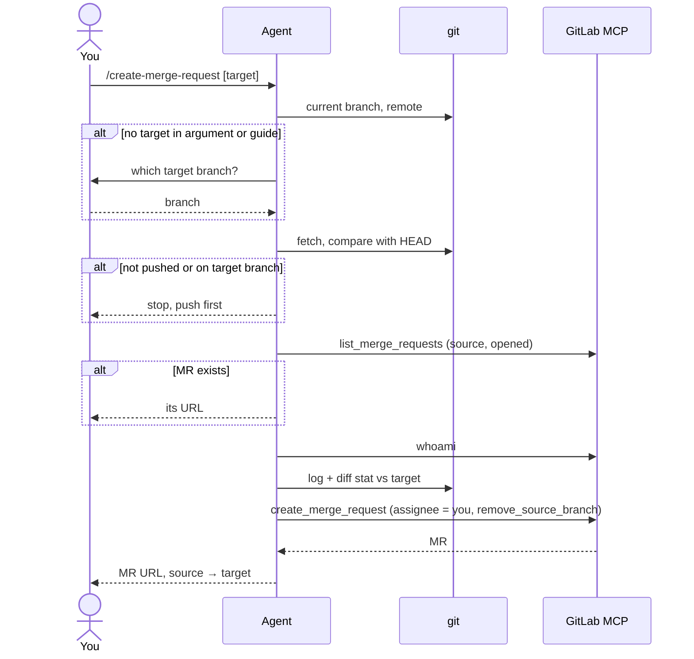

# create-merge-request

Opens a GitLab merge request for the current branch through the GitLab MCP. You are the assignee, and delete source branch is always on.

## When to use it

- The branch is pushed and you want an MR with a written title and description.
- `/create-merge-request` takes the target branch from your guide (`CLAUDE.md` / `AGENTS.md`), else asks you. `/create-merge-request <branch>` overrides it.

| You want | Use instead |
|----------|-------------|
| Rewrite the text of an MR that exists | `update-merge-request` |
| A copy-paste changelog | `generate-changelog` |

## Defaults

| Setting | Value |
|---|---|
| Target branch | Argument, else the branch your guide names for this repo, else asks you |
| Assignee | You |
| Delete source branch | Always on |

## How it works

## Prerequisite

A GitLab MCP server whose host matches `origin` (the `setup-device` skill installs `gitlab-prod-mcp`).

## Files in the skill folder

| Path | What |
|------|------|
| [SKILL.md](SKILL.md) | The agent's instructions |
