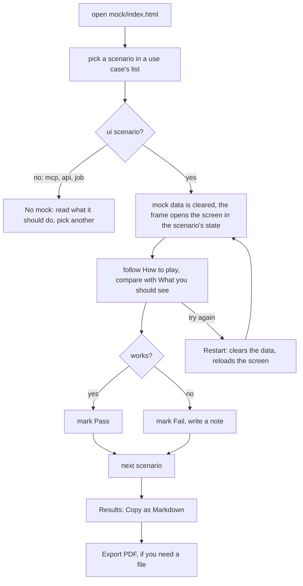

# Mock UI

A clickable mock of this feature's screens, in the app's design system, with data shaped like the real API answers and every edge state. Play each screen scenario and mark it Pass or Fail.

The scenario lists show every scenario of the feature, in the same order as the other tools. MCP, API and job scenarios are greyed: picking one shows "No mock". Play those with the `play-scenarios` skill, or test them with `e2e-test`.

## How to open it

1. Open `mock/index.html` in a browser, straight from disk. No server, no build.

    ```bash
    open mock/index.html        # macOS
    xdg-open mock/index.html    # Linux
    ```

2. Keep `mock/` inside the plan folder: its pages read `../use-cases.js`.
3. Be online: the screens load the app's CSS framework from a CDN.

To open one screen in one state, without the index:

```
mock/page/<screen>.html?state=<state id>
```

The pink, dashed **Mock state** panel on that screen switches states. It is mock-only, not part of the product.

## Using it



- Each pick and each Restart starts clean. The audit log shows what the real service would write.
- To test again, **Clear** in a use case's scenario list drops its Pass / Fail and notes. **Clear all** (bottom right) drops them for the whole page.
- Pass / Fail marks and notes stay in this browser only. Copy them before you switch browsers.
- **Core** marks a scenario to play first. The filter bar under the title shows only some kinds (Basic, Alternate, Exception) or only core scenarios; "n of N" counts what is shown. The Results line shows core results apart.
- `#sc-<id>` at the end of the URL opens that scenario. The plan's Play links use it.

## Files

| File | What |
|------|------|
| `index.html` | The play page: one block per use case (scenario list with the open one's steps, framed screen), Results, audit log, contract links |
| `page/<screen>.html` | One screen; its state comes from `?state=` and the params a scenario needs |
| `contract/types.ts` | The real request, response and error shapes to implement |
| `contract/rules.js` | The spec's rules and screen texts; the screens and their data run them |
| `contract/data.js` | Mock data in the real upstream shapes |
| `shared/scenario-play.js` | How to play each screen scenario: state, page, steps |
| `shared/states.js` | The screens, and each mock state's data, permissions and faults |
| `shared/fake-api.js` | Local data for the screens: the real operation names, request and answer shapes |
| `shared/components.js` | The app's component class strings |
| `shared/shell.js` | The app's chrome, plus the mock-only state / scenario panel |
| `../use-cases.js` | The use cases and scenarios this mock plays |

## When it fails

| You see | Do this |
|---------|---------|
| Blank index; the browser console says `USE_CASES is not defined` or `SCENARIOS is not defined` | `../use-cases.js` is missing. Open the mock from inside its plan folder. |
| Screens have no styling | The CSS framework loads from a CDN. Go online and reload. |
| A screen opened on its own shows rows from an earlier try | Press `Reset mock data` (or `Start over`) in the pink panel. |
| Pass / Fail marks are gone | They live in this browser's storage. A private window or cleared site data loses them; copy the Results table first. |
| An error or empty state in a screen | Check the state label above the frame. Many scenarios show an error on purpose. |
