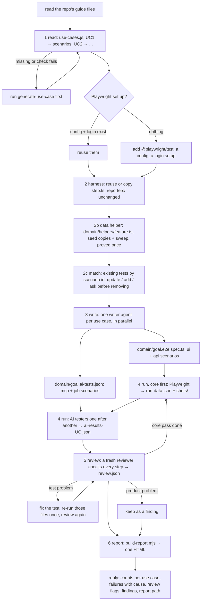
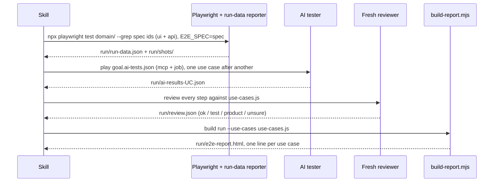
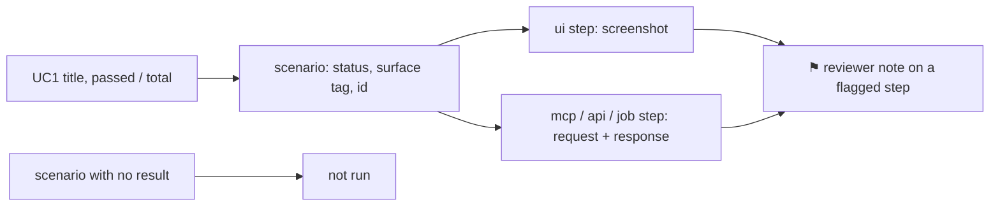

# e2e-test

Writes and runs automated tests for every scenario in a feature's `use-cases.js`, on every surface: the browser (`ui`), direct API calls (`api`), MCP tools (`mcp`) and scripts (`job`). A fresh reviewer agent then checks every step, and one self-contained HTML report shows it all, in the same use case tree as every other skill.

## When to use it

- You want a feature tested end to end, with proof of every step: a screenshot, or the request and response.
- You want the MCP side tested by an AI agent, the way users reach it.
- You want one shareable file, grouped by use case and scenario.
- Say: "e2e test spec 127", "test this end to end".

| You want | Use instead |
|----------|-------------|
| Write or fix the use cases and scenarios | `generate-use-case` |
| Play the scenarios by hand on the running app | `play-scenarios` |
| Check after a deploy that services reach each other | `smoke-test` |
| A clickable mock with fake data | `generate-mock-ui` |

## How it works

Six phases, plus the data helper. The harness is added once per repo; the rest runs per feature.



The runner per scenario comes from its `surface`; nothing is grouped or split by surface:

| surface | Runner | Proof per step |
|---|---|---|
| `ui` | Playwright browser test, `step()` | screenshot |
| `api` | Playwright request test, `apiStep()` | masked request + response |
| `mcp` | AI tester agent calling the local MCP tools as the scenario's role | each call, request + response |
| `job` | AI tester agent running the command | command, exit code, output |

One run, end to end:



How the report shows it:



Rules the diagrams don't show:

- `use-cases.js` is the one source. It never writes its own test cases; a wrong scenario is fixed in `generate-use-case`.
- Tests only. It never changes app code to make a test pass; a missing selector or a bug is a finding.
- Each test works on its own copies of the seed records its scenario names (`<seed name>-e2e<N>-<tag>`), deleted after, checked gone.
- No tokens, cookies or passwords in any recorded call.
- Never against production unless named for this run.
- The repo's own guide (where tests live, how to run tools) wins over the skill.
- Report: use-cases.js order by default, a "Failed first" toggle, every test starts closed, filters use Playwright's own outcome, retries under "Earlier attempts", flaky tests marked, Export PDF.

## Input → output

Input: `<plan folder | spec folder | spec number> [--env <name>] [--base-url <url>]`

- No `--env` or `--base-url` → the repo's local dev URL.

Output, in the target repo:

```
<plan>/use-cases.js                       read only (from generate-use-case)
<e2e-dir>/
├── README.md                             how to run the tests, for teammates
├── support/step.ts                       step() screenshot per step, apiStep() request + response per step, reveal()
├── reporters/
│   ├── run-data-reporter.ts              writes the run folder, no HTML
│   ├── build-report.mjs                  run folder → one HTML
│   └── e2e-report-template.html          the report page, dark theme, Export PDF
├── <domain>/                             latest version, edited in place by every spec
│   ├── helpers/<feature>.ts              seed copies, name map, sweep()
│   ├── <goal>.e2e.spec.ts                ui + api scenarios of one use case (no UC number)
│   ├── <goal>.ai-tests.json              mcp + job scenarios of one use case
│   └── <goal>.data.mts                   setup / cleanup command for the AI tester (one pattern for all)
└── e2e-results/                          gitignored
    └── <spec or _adhoc>/                 one folder per spec, updated by every run
        ├── run-data.json                 latest result of each test
        ├── shots/                        step screenshots
        ├── ai-results-<UC>.json          AI tester results
        ├── review.json                   reviewer notes per step
        └── e2e-report.html
```

Plus a `playwright.config.*` and login setup when the repo had none.

## Files in the skill folder

| Path | What |
|------|------|
| [SKILL.md](SKILL.md) | The agent's instructions and the file formats |
| [references/data-helper-agent.md](references/data-helper-agent.md) | Prompt for the data helper agent: seed copies, naming, sweep, runner |
| [references/writer-agent.md](references/writer-agent.md) | Prompt for each writer agent: per-surface rules, selectors, data, waits |
| [references/ai-tester-agent.md](references/ai-tester-agent.md) | Prompt for the AI tester: plays mcp and job scenarios, records each call |
| [references/reviewer-agent.md](references/reviewer-agent.md) | Prompt for the fresh reviewer: the per-step checklist and flags |
| [template/step.ts](template/step.ts) | `step()`, `apiStep()` and `reveal()` |
| [template/run-data-reporter.ts](template/run-data-reporter.ts) | Playwright reporter: writes `run-data.json` + `shots/` |
| [template/build-report.mjs](template/build-report.mjs) | Merges the run folder into one HTML |
| [template/e2e-report-template.html](template/e2e-report-template.html) | The report page the build fills in |
| [template/README.md](template/README.md) | Ships as the e2e folder's `README.md` |

## Related skills

- `generate-use-case`: writes `use-cases.js`, the scenarios this skill tests.
- `play-scenarios`: the same scenarios, played by hand.
- `design-feature`, `generate-mock-ui`: the same use case tree, as a plan and a mock.
- `smoke-test`: service checks after a deploy, not the feature.
