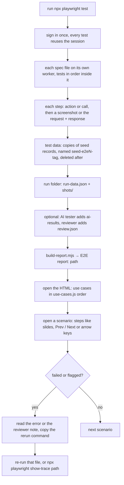

# E2E tests

Automated tests for the app's scenarios, one test per scenario in a spec's `use-cases.js`. Tests are kept by domain (`<domain>/`) and always match the latest code: a later spec updates them in place. Reports are kept by spec: one folder, `e2e-results/<spec>/`, updated by every run. Browser steps take a screenshot; API steps record the request and response. MCP and job scenarios are played by an AI agent. Every run ends in one HTML report.

## How to run it

1. Start the app, or pick the environment to test. Never production unless that is the plan for this run.

2. Run the Playwright tests (ui + api scenarios), from the repo root or the folder that holds the Playwright config:

    ```bash
    E2E_SPEC=<NNN-slug> PW_BASE_URL=http://localhost:3000 npx playwright test <e2e-dir>/<domain>/
    ```

    - `E2E_SPEC` is the spec folder name. Every run goes to `e2e-results/<NNN-slug>/`; left out → `e2e-results/_adhoc/`. A run replaces the tests it ran and keeps the rest, so the folder always holds the latest result of each test. Delete it for a clean start.
    - `PW_BASE_URL` is the app to test. Left out → the config's local URL.
    - From the repo root, add `--config <path to playwright.config.*>`.
    - Add a file path to run one use case only, or `--grep " (<scenario id>|…) "` to run only one spec's scenarios.
    - The repo's guide may say to run tools another way (for example inside Docker). Follow it.

3. MCP and job scenarios (`*.ai-tests.json`): ask your AI agent to run the `e2e-test` skill, or to play the file with the skill's AI tester prompt. It writes `ai-results-<UC>.json` into the same run folder. Skip this step when you only need the browser and API tests.

4. Build the report:

    ```bash
    node <e2e-dir>/reporters/build-report.mjs e2e-results/<NNN-slug> --use-cases <plan>/use-cases.js
    ```

    It writes `e2e-results/<NNN-slug>/e2e-report.html`, prints one line per use case and `E2E report: <path>`. Open that file.

## Using it



- The report is one file with the screenshots inside. Share it as-is, or use Export PDF.
- Use cases and scenarios come in `use-cases.js` order; each scenario shows its id, a surface tag (`ui`, `api`, `mcp`, `job`) its kind (`basic`, `alternate`, `exception`) and a Core pill on core scenarios. Core scenarios come first in each use case. "Failed first" lifts failures to the top.
- A core-only run (`--grep @core`, report built with `--core`) shows only the core scenarios.
- ⚑ marks a step a reviewer flagged: "Test problem" (fix the test), "Product problem" (a bug), "Check by hand".

## Files

| File | What |
|------|------|
| `<domain>/<goal>.e2e.spec.ts` | ui + api scenarios of one use case (named by its goal, no UC number); one `test()` per scenario |
| `<domain>/<goal>.ai-tests.json` | mcp + job scenarios of one use case, as ordered calls or commands for the AI tester |
| `<domain>/<goal>.data.mts` | Setup / cleanup command the AI tester runs for one use case |
| `support/step.ts` | `step()` (screenshot per step), `apiStep()` (request + response per step) and `reveal()` (scroll into view) |
| `<domain>/helpers/<feature>.ts` | Copies the seed records a scenario names (`<seed name>-e2e<N>-<tag>`), deletes them, `sweep()` clears leftovers |
| `reporters/run-data-reporter.ts` | Writes the run folder: `run-data.json` + `shots/` |
| `reporters/build-report.mjs` | Merges the run folder into one HTML |
| `reporters/e2e-report-template.html` | The report page; dark theme, Export PDF |
| `e2e-results/<spec>/` | One folder per spec (`_adhoc/` when none) with the latest result of each test and `e2e-report.html`; gitignored |
| `playwright.config.*` | Base URL, viewport, workers, reporters, login state |

## When it fails

| You see | Do this |
|---------|---------|
| `net::ERR_CONNECTION_REFUSED` on every test | The app is not running at `PW_BASE_URL`. Start it, then re-run only the failed files. |
| Tests land on the sign-in page | The saved login state expired. Re-run so the global setup signs in again; check the login env vars. |
| `ENOENT` … `e2e-report-template.html` | `build-report.mjs` looks for the template next to itself. Keep both in `reporters/`, or pass `--template <path>`. |
| `No data in this report.` | You opened `reporters/e2e-report-template.html` itself. Open the file in the run folder instead. |
| Every scenario "not run" | Wrong run folder (use the path printed as `E2E run data: <path>`), `--use-cases` points to another feature's file, or the tests have no `scenario` annotation. |
| `No screenshot for this step` | That step's screenshot failed (the page was closed or crashed). Read the step's error. |
| A test marked flaky | It passed on a retry. Open "Earlier attempts" to see the failed try. |
| A failed step with a real error | Keep it: it is a product bug or a wrong selector. Use the copied rerun command after a fix. |
