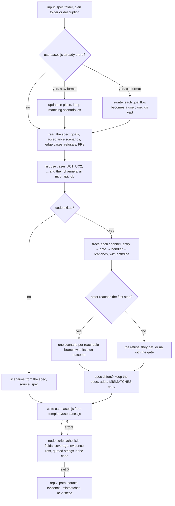
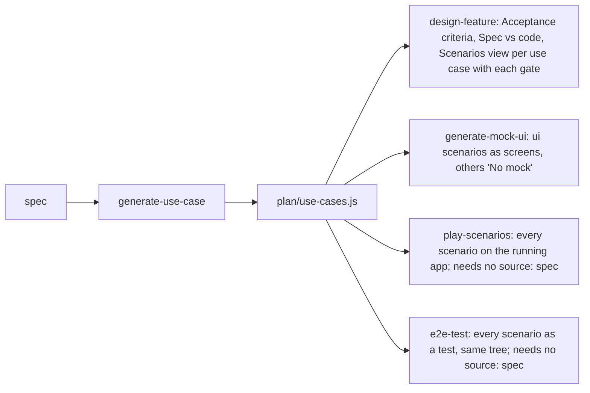
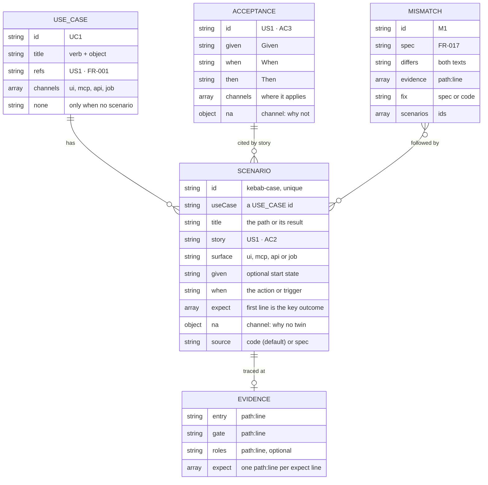

# generate-use-case

Writes a feature's use cases (one per user goal), their scenarios (one per rule or outcome, not per click or value, on every channel: UI, MCP, API, job) and the spec's acceptance criteria to one `use-cases.js` file. Every skill that plays or tests the feature reads it and shows the same tree: use case → scenarios.

The code is the source of truth. The spec says which goals to cover; each scenario is traced in the code from its entry point and carries `file:line` evidence. Where the spec and the code disagree, the scenario follows the code and the gap goes in `MISMATCHES` for you to decide.

## When to use it

- You have a spec or an idea, and you want the list of what users can do and what they should see.
- You are about to plan, mock, play or test a feature: those skills read this file and never write their own.
- An old `use-cases.js` (`USE_CASE_FLOWS`) needs moving to the new format.
- After a merge or refactor, re-check an existing file against the code (verify mode).
- Say: "use cases for spec 127", "list the use cases", "verify the use cases of spec 127".

| You want | Use instead |
|----------|-------------|
| The full feature plan with flows, database and API | `design-feature` |
| A clickable mock where you play each scenario | `generate-mock-ui` |
| Play the scenarios by hand on the running app | `play-scenarios` |
| Automated browser tests with screenshots | `e2e-test` |

| Word | Meaning | Example |
|------|---------|---------|
| Use case | One goal a user wants to reach, verb + object | Cut a new version |
| Scenario | One path through a use case, with one result, on one channel | Merge request already released |
| Kind | How a scenario ends: `basic` (the main path), `alternate` (another path to the goal), `exception` (the goal is not reached) | exception |
| Core | Play it first: every `basic`, plus the main alternates and the errors users hit most (about 15–25% of all) | `"core": true` |
| Channel | Where a user reaches it: `ui`, `mcp` (an AI agent), `api` (REST / gRPC), `job` | mcp |
| Acceptance criterion | One Given / When / Then from the spec | US1 · AC3 |
| Evidence | Where a scenario lives in the code: entry point, the gate on the actor, the code behind each expect line | `apps/web/lib/config/routes.ts:452` |
| Mismatch | One place the spec and the code disagree, with the side to fix | M1 · FR-017 · fix the spec |

## How it works

Four steps. `check.js` gates the file before the reply.



Verify mode re-checks an existing file: `check.js` finds missing files, moved lines and strings no longer in the code; a re-trace from each `evidence.entry` finds changed gates and outcomes. It reports drift with proposed edits and changes the file only when you agree.

Who reads the file:



The data in the file:



Rules the diagrams don't show:

- Every channel is covered: each outcome has one scenario per channel of its use case, or an `na` reason. MCP scenarios name the tool, its arguments and the exact answer or error.
- All three arrays are strict JSON after `var NAME = `, so a page on `file://` loads the file with `<script src>` and a script parses it.
- The spec picks the goals; the code decides what each scenario says happens. A spec outcome behind a gate the actor can't pass becomes the refusal they really get.
- Every scenario carries evidence; `check.js` fails on a missing ref, a missing file or a line out of range.
- No code yet → `source: "spec"`; play-scenarios and e2e-test refuse those until verify mode traces them.
- Every scenario carries a concrete, true example: real versions, counts, ids, a request → answer, or a script's output line.
- Quoted text is copied from the code; `check.js` searches the repo for each quoted string and fails when one is missing. Spec text that differs goes in `MISMATCHES`, which the reply lists last.
- A role scenario names the role and its exact permission strings ("DEV: has repositories.versions.read, not repositories.versions.create"), read from seed migrations or role-permission tables, never from spec prose.
- No mock or test details: no state ids, pages, query params or selectors. Example values are fine.
- Ids are stable. Other files link to `#sc-<scenario id>`.
- Every count in the reply comes from `check.js`.

## Input → output

Input: `[verify] <spec-folder | plan-folder | use-cases.js | feature description> [output-folder]`

| Input | Where the file goes |
|-------|---------------------|
| Output folder given | that folder |
| Plan folder (has `overview.html`) | the plan folder |
| Spec folder or number | `<spec-folder>/plan/` |
| Feature description | `plans/<feature-slug>/` at the project root |

Output: the data file and its type.

```
<plan>/
├── use-cases.js            var USE_CASES, SCENARIOS, ACCEPTANCE, MISMATCHES = [...]
└── use-cases.types.d.ts    the type of every field (copied from template/)
```

## Files in the skill folder

| Path | What |
|------|------|
| [SKILL.md](SKILL.md) | The agent's instructions |
| [template/use-cases.js](template/use-cases.js) | Example file: 3 use cases, 18 scenarios across `ui`, `mcp` and `job` with evidence (one `source: "spec"`), 6 acceptance criteria, 1 mismatch |
| [template/use-cases.types.d.ts](template/use-cases.types.d.ts) | The type of every field; synced from `theme/use-cases.d.ts`, never edited here |
| [scripts/check.js](scripts/check.js) | Checks the file; prints the scenario count per use case and channel, the acceptance coverage, the evidence count and each mismatch; errors on a field the type does not have, a channel or acceptance criterion with no scenario, missing or broken evidence refs, and a quoted string not in the code; warns on a scenario with no twin on another channel, no example, a role with no permission string, or `source: "spec"` (an error with `--strict`); `--root <repo>` when the file is outside the repo; `--json` for machine output; exit 1 on any error |

## Related skills

- `design-feature`: shows the acceptance criteria with their scenarios, and each use case's Scenarios view.
- `generate-mock-ui`: mocks each `ui` scenario; the others show "No mock".
- `play-scenarios`: plays every scenario on the running app.
- `e2e-test`: runs every scenario as an automated test; its report follows the same tree.
