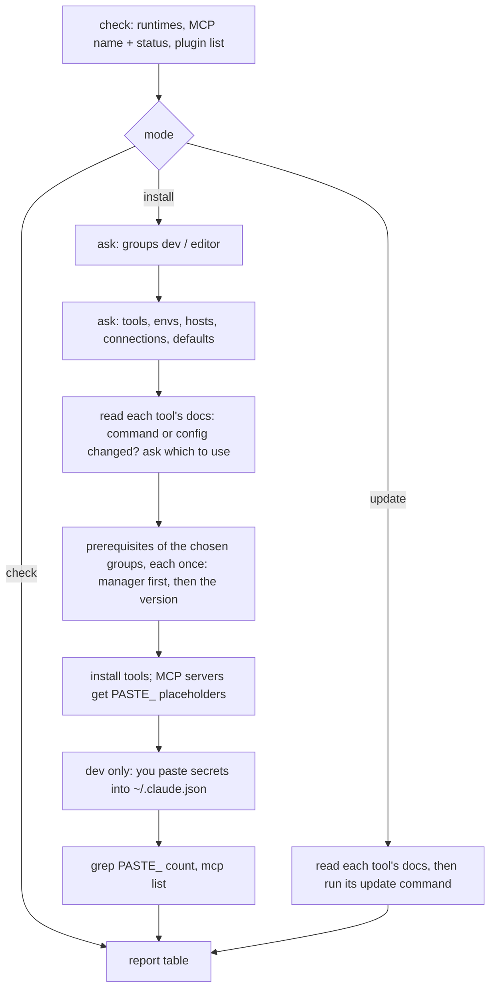

# setup-device

Installs your tools by group on a new or existing machine: prerequisites first, then the tools. You paste the secrets yourself.

## When to use it

- A new laptop, or a teammate setting up.
- You want to check what is missing, or update what is there.
- Say: "set up this device", "install my tools", "install the editor tools", "update my MCP servers".

## What it installs

It asks which groups first: `dev`, `editor` or both.

| Prerequisite | Through | Version | Group |
|--------------|---------|---------|-------|
| Homebrew | its own installer | latest | editor |
| ffmpeg | Homebrew | latest | editor |
| uv | its own installer | latest | dev, editor |
| Node + npm | nvm | 24 LTS | dev, editor |
| Python | uv | 3.14 | dev |
| Java | SDKMAN | 25 LTS (Temurin) | dev |

It installs a missing version manager first, and only adds versions: it never removes one or touches the OS Python.

**Dev**

| Tool | Kind | Used by |
|------|------|---------|
| [gitlab-mcp](https://github.com/zereight/gitlab-mcp) | MCP | review-code, get-mr-diffs, generate-changelog, update-merge-request, deployment-plan |
| [mcp-jenkins](https://github.com/lanbaoshen/mcp-jenkins) | MCP | check-job |
| [omnisql-mcp](https://github.com/srthkdev/omnisql-mcp) | MCP | database questions |
| [diagram-design](https://github.com/cathrynlavery/diagram-design) | plugin | diagrams |
| [mattpocock skills](https://github.com/mattpocock/skills) | plugin | ship-task (grilling) |
| [ui-ux-pro-max](https://github.com/nextlevelbuilder/ui-ux-pro-max-skill) | plugin, opt-in | UI design |
| [impeccable](https://github.com/pbakaus/impeccable) | plugin, opt-in | UI review |
| [Mobbin](https://mobbin.com/mcp) | MCP, opt-in | real app UI references |
| [spec-kit](https://github.com/github/spec-kit) | CLI, opt-in | spec-driven development (`specify init` per repo) |
| [ponytail](https://github.com/DietrichGebert/ponytail) | plugin, opt-in | smallest-change coding style |
| [caveman](https://github.com/JuliusBrussee/caveman) | plugin, opt-in | short replies |

Opt-in tools are offered but never selected by default.

It adds Anthropic's `claude-plugins-official` marketplace when missing. From it, only `mattpocock-skills` installs by default; any other plugin there is opt-in.

**Editor**

| Tool | Kind | Install |
|------|------|---------|
| [yt-dlp](https://github.com/yt-dlp/yt-dlp) | CLI | `uv tool`, set to use Node for YouTube |
| [whisper](https://github.com/openai/whisper) | CLI | `uv tool`, Python 3.12, large PyTorch download |
| [remotion](https://github.com/remotion-dev/remotion) | agent skills | `npx skills`, global |
| [hyperframes](https://github.com/heygen-com/hyperframes) | agent skills | `npx skills`, global; asks before `media-use` |

## How it works



- MCP servers are named `<tool>-<env>-mcp` at user scope: `gitlab-prod-mcp`, `jenkins-prod-mcp`, `omnisql-local-mcp`. Mobbin has no envs: `mobbin-mcp`, signed in through `/mcp`.
- It never sees your tokens. It never overwrites a server or plugin you already have.
- It reads `claude mcp list` as name and status only, so a token in a server's args never shows.
- The Jenkins token goes in an env var, not in the command args, so `ps` does not show it.

## Input → output

```
setup-device [all | dev | editor | <tool or prerequisite> ...] [check | update]
```

Output: a table per group and tool (installed, already there, updated, needs secret, skipped, failed) and the steps left for you.

## Files

| File | Purpose |
|------|---------|
| `SKILL.md` | Workflow |
| `references/tools.md` | Each tool's install, secret and update commands. Add a tool here. |
