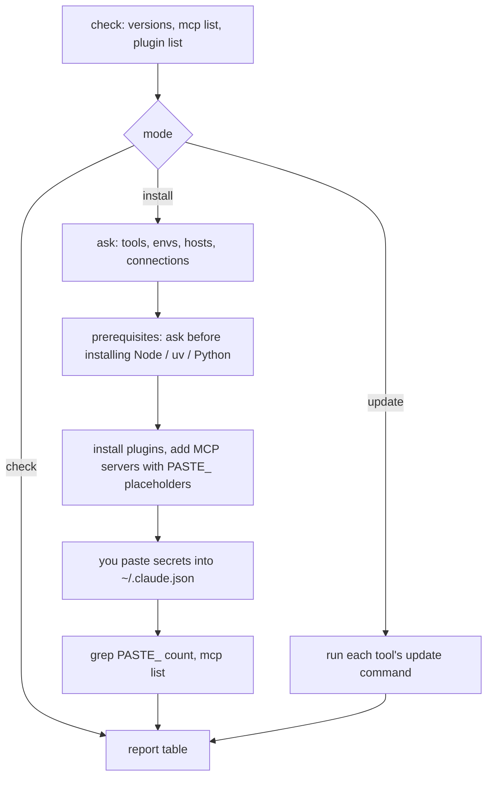

# setup-device

Installs the MCP servers and plugins the naphatwx skills use, on a new or existing machine. You paste the secrets yourself.

## When to use it

- A new laptop, or a teammate setting up.
- You want to check what is missing, or update what is there.
- Say: "set up this device", "install my tools", "update my MCP servers".

## What it installs

| Tool | Kind | Used by |
|------|------|---------|
| [gitlab-mcp](https://github.com/zereight/gitlab-mcp) | MCP | review-code, get-mr-diffs, generate-changelog, update-merge-request, deployment-plan |
| [mcp-jenkins](https://github.com/lanbaoshen/mcp-jenkins) | MCP | check-job |
| [omnisql-mcp](https://github.com/srthkdev/omnisql-mcp) | MCP | database questions |
| [diagram-design](https://github.com/cathrynlavery/diagram-design) | plugin | diagrams |
| [mattpocock skills](https://github.com/mattpocock/skills) | plugin | ship-task (grilling) |
| [ui-ux-pro-max](https://github.com/nextlevelbuilder/ui-ux-pro-max-skill) | plugin | UI design |
| [impeccable](https://github.com/pbakaus/impeccable) | plugin | UI review |

## How it works



- MCP servers are named `<tool>-<env>-mcp` at user scope: `gitlab-prod-mcp`, `jenkins-prod-mcp`, `omnisql-local-mcp`.
- It never sees your tokens. It never overwrites a server or plugin you already have.
- The Jenkins token goes in an env var, not in the command args, so `ps` does not show it.

## Input → output

```
setup-device [all | <tool> ...] [check | update]
```

Output: a table per tool (installed, already there, updated, needs secret, skipped, failed) and the steps left for you.

## Files

| File | Purpose |
|------|---------|
| `SKILL.md` | Workflow |
| `references/tools.md` | Each tool's install, secret and update commands. Add a tool here. |
