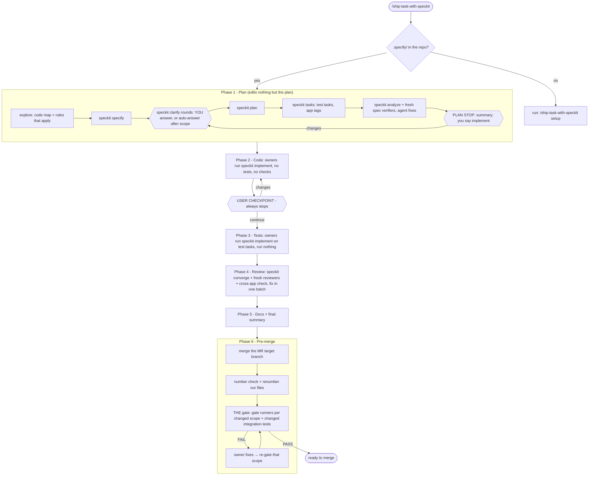

# ship-task-with-speckit

The `ship-task` phases, with [Spec Kit](https://github.com/github/spec-kit) writing the plan and the code. One flow for features, bug fixes and hotfixes.

## When to use it

- You want Spec Kit's spec → plan → tasks → implement flow, but with ship-task's stops, review and pre-merge gate.
- Needs the `specify` CLI and Spec Kit core in the repo: run `/ship-task-with-speckit setup` once per repo.
- Run: `/ship-task-with-speckit add CSV export to the users page` (add `auto-answer` to let a decider answer the clarify questions after scope), `/ship-task-with-speckit 043` to resume task 043, or `/ship-task-with-speckit` for status.
- Slash only. The agent never starts it by itself.

| You want | Use instead |
|----------|-------------|
| The same phases without Spec Kit | `ship-task` |
| A full HTML plan of a feature, no code | `design-feature` |
| A review of a diff you already have | `review-code` |

## How it works



- `setup` installs the `specify` CLI if you agree, asks which agent to install for, and runs `specify init --here --force --integration <agent>` on a clean tree: Spec Kit core only, no extensions. It then offers a constitution and a flow profile.
- Your three stops: the clarify questions, the plan stop, and the checkpoint after code. No plan mode.
- Clarify questions that the project's rules already answer are answered for you, with the source, and listed at the plan stop so you can overrule one.
- Spec Kit's test-first order is not used: code comes in Phase 2, tests in Phase 3, after you try the code.
- No build, lint or test runs before Phase 6, unless you ask for a gate.
- How work is split across sub-agents (per app, per folder, one for all) is the repo's rule: the profile's `Agent split`, else the root guide, else one agent per role. Reviewers are always fresh agents.

## Input → output

Input: `<setup | what you want | task number [phase] | (empty)>`

Output:

```
specs/NNN-<slug>/
├── status.md      always: status lines and the Status snapshot, read on every resume
├── spec.md        Spec Kit: user stories, FR-###, SC-###, edge cases, Clarifications
├── plan.md        Spec Kit: technical context, Constitution Check, structure
├── research.md    Spec Kit, when needed: decisions with rationale and alternatives
├── data-model.md  Spec Kit, when needed
├── contracts/     Spec Kit, when needed
├── quickstart.md  Spec Kit: the steps you run at the checkpoint
├── tasks.md       Spec Kit: tasks with [app] and [TEST] tags, citing FR/SC ids
└── log.md         dated history that git does not hold
```

Plus the code, tests and docs changes on the working branch. Nothing is committed unless you ask.

## Files in the skill folder

| Path | What |
|------|------|
| [SKILL.md](SKILL.md) | The agent's instructions: phases, Phases 2–3 and the checkpoint, hard rules |
| [references/setup.md](references/setup.md) | The `setup` option |
| [references/plan.md](references/plan.md) | Phase 1: explore, the Spec Kit skills, clarify rounds and auto-answer, plan stop |
| [references/review-docs.md](references/review-docs.md) | Phases 4–5 |
| [references/pre-merge.md](references/pre-merge.md) | Phase 6 and gates on request |
| [references/profile.md](references/profile.md), [references/roles.md](references/roles.md) | Copies of ship-task's, kept in step by `node theme/sync.mjs` |
| [assets/status-template.md](assets/status-template.md) | `status.md` |

## Related skills

- `ship-task`: the same phases with its own plan files.
- `review-code`: reviewers may use it for the diff.
- `play-scenarios`: try the code by hand at the checkpoint.
