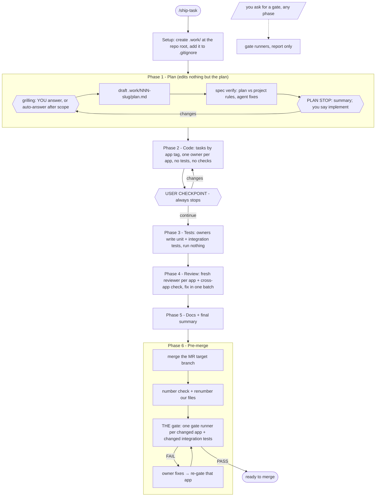

# ship-task

Carries one feature, bug fix or hotfix from idea to a merge-ready branch, in the same phases on every project.

## When to use it

- You start a feature, bug fix or hotfix and want a fixed flow: plan, code, your review, tests, AI review, docs, pre-merge gate.
- Needs Matt Pocock's `grilling` skill: `/plugin install mattpocock-skills@claude-plugins-official`.
- You want sub-agents to write the code, one per app, and fresh sub-agents to review it.
- Run: `/ship-task add CSV export to the users page` (add `auto-answer` to skip the grill after scope), or `/ship-task 127` to resume task 127, or `/ship-task` for status.
- Slash only. The agent never starts it by itself.

| You want | Use instead |
|----------|-------------|
| A full HTML plan of a feature, no code | `design-feature` |
| Only the use cases and scenarios | `generate-use-case` |
| A review of a diff you already have | `review-code` |
| To try the scenarios by hand on the running app | `play-scenarios` |

## How it works



- Setup runs first, every time: it creates `.work/` at the repo root and adds it to `.gitignore` when either is missing.
- Your three stops: the grilling questions, the plan stop (a summary of what will be built; say `implement` to go on), and the checkpoint after code. No plan mode.
- Auto-answer: write `auto-answer` in the input or in a grill reply. You still answer the scope question; a decider sub-agent answers the rest and gives the final yes. Its answers are marked `(auto)` in the plan.
- The grill never asks what the project's rules already answer (guides, ADRs, existing code patterns). Those go in the plan as `(rule: <source>)`, and the plan stop lists them so you can overrule one.
- Spec verify checks the plan against the project's rules, not the requirements. The agent fixes what it finds; a decider sub-agent settles disputes.
- At the checkpoint you try the code first; tests come after you confirm.
- No build, lint or test runs before Phase 6, unless you ask for a gate.
- The main agent only orchestrates. App code is changed by the app's owner sub-agent.

## Project profile

The flow reads a `## Flow profile` section in the project's root `AGENTS.md` or `CLAUDE.md`: apps, guides, owner agents, gate commands, integration tests, numbered folders, docs paths. With no profile, it detects what it can, asks you for the rest, and offers to save it. See [references/profile.md](references/profile.md).

## Input → output

Input: `<what you want | task number [phase] | (empty)>`

Output:

```
.work/NNN-<slug>/
└── plan.md   always: status lines, Goal, Status, Accept (A#, new/changed/removed), Decisions (D#, [ADR]), Tasks
              when needed: Edge cases (E#), Out of scope, Context, Open questions, Rules check (open only),
              Changes, Data/API (links plan/ files), Risks, Verify locally, Release & rollback
```

- A bug fix with one cause gets a small plan: Goal (bug and cause), Status, Accept, Tasks.
- A section with nothing to say is left out. Order lives only in each task's `after:`.
- One fact lives in one place. A changed fact is replaced, marked `(supersedes …)`; no history piles up.
- Each owner agent gets its tasks plus the A#, D# and E# lines they cite, not the whole plan.
- Tasks cite the A#, D# and E# they cover, so review can check every requirement has code and a test.
- `## Status` is updated at every phase end, so a new session picks up from the file alone.
- An older plan without these sections is moved to the new shape only when you say yes.

Plus the code, tests and docs changes on the working branch. Nothing is committed unless you ask.

## Files in the skill folder

| Path | What |
|------|------|
| [SKILL.md](SKILL.md) | The agent's instructions: phases, Phases 2–3 and the checkpoint, hard rules |
| [references/profile.md](references/profile.md) | The project profile and how to detect it |
| [references/roles.md](references/roles.md) | Prompts for owner, reviewer, spec verifier, gate runner, decider |
| [references/plan.md](references/plan.md) | Phase 1: number, explore, grilling and auto-answer, draft, spec verify, plan stop |
| [assets/plan-template.md](assets/plan-template.md) | The full shape of `plan.md` |
| [assets/plan-template-fix.md](assets/plan-template-fix.md) | The small shape, for a bug fix with one cause |
| [references/review-docs.md](references/review-docs.md) | Phases 4–5 |
| [references/pre-merge.md](references/pre-merge.md) | Phase 6 and gates on request |

## Related skills

- `grilling` (mattpocock-skills): the Phase 1 questions.
- `generate-use-case`, `design-feature`: can take the task folder as input.
- `review-code`: reviewers may use it for the diff.
- `play-scenarios`: try the code by hand at the checkpoint.
