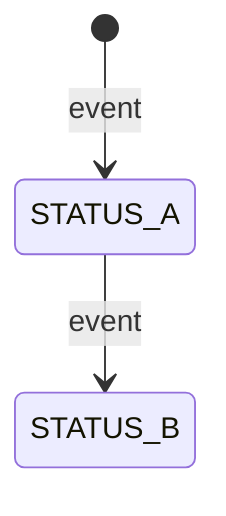

# NNN · Data / API
- Contracts: [plan/api/contracts.html](plan/api/contracts.html) · Tables: [plan/database/er-diagram.html](plan/database/er-diagram.html)

## Tables
- `{table}`: `{column}` {type, null, default} — {meaning}
- Migrations: {number} {name} — {what}; down: {what}

## Status flow

## RPCs and routes
| Route | RPC / handler | Permission |
|---|---|---|
| `{METHOD} {path}` | `{name}` | `{permission}` |

## Refusal reasons and texts
| Reason | Code |
|---|---|
| `{REASON}` | {code} |

- {case} (`{REASON}`): "{message}"

## Messages and events
- {queue / exchange / routing key / event}: {body example}

## External contracts
- {job or service}: {parameters, calls, exit codes, reports}

## Env vars
| App | Name | Value |
|---|---|---|
| {app} | `{NAME}` | `{value}` |
