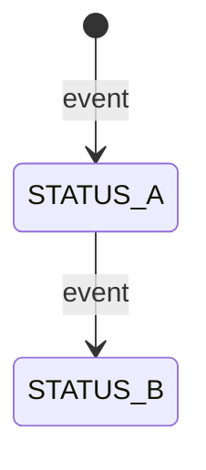

# NNN · {Title} ({ticket id, if any})
- Phase: 1 · Apps: {apps} · Target: {MR/PR target per repo, or "not known yet"} · Next: {one line}
- Branch: {branch per repo, or "not cut yet"} · Updated: {YYYY-MM-DD}

## Goal
- {what users can do after this ships}
- {why: the problem it removes}

## Status
- Phase: {phase and its state}
- Done: {phases or tasks finished}
- Written, not run: {code or tests not built or run yet | nothing yet}
- Open: {open questions and reviews | none}
- Next: {the next 1–3 steps}

## Accept
- **A1 {Topic}:** {role} can {action}. {What the user sees.}
- **A2 {Topic}:** {rule}.
  - Reason: `{REFUSAL_REASON}`
  - Message: "{What is wrong}. {What to do next}."

## Edge cases
- **E1 {Case}:** {input or state} → {what happens, with the exact message}.

## Out of scope
- {thing not built} ({source})
- Known gap: {thing that stays broken} ({who accepted it})

## Context (facts checked)
- {count, size, limit or existing behaviour}: {value} (checked {YYYY-MM-DD}, {where})

## Dependencies & assumptions
- Depends on: {other repo MR, job, env var, existing feature}
- Assumes: {thing that must stay true}

## Decisions

**Scope**
- D1 {question} → {answer} ({source})

**Data**
- D2 [ADR] {question} → {answer} ({source})
  - why: {reason} · rejected: {alternative | not recorded}

**API**
- D3 {question} → {answer} ({source})

**UI**
- D4 {question} → {answer} ({source})

**Jobs / workers**
- D5 {question} → {answer} ({source})

**Ops**
- D6 {question} → {answer} ({source})

## Open questions
- Q1 {question} — decides: {who} · needed before: {phase or task}

## Rules check
- [x] {project rule} — {how the plan meets it} (D#)
- [ ] {project rule} — {what is still to check, and when}

## Changes per app
- {app} (`{folder}`):
  - `{path}` (new) — {what}
  - `{path}` (edit) — {what}
- Main agent: {docs, root config}
- User steps: {env vars, job config, other things only the user can do}

## Data / API

### Tables
- `{table}`: `{column}` {type, null, default} — {meaning}
- Constraints: {unique, FK, check}
- Migrations: {number} {name} — {what}; down: {what}

### Status flow


### RPCs and routes
| Route | RPC / handler | Permission |
|---|---|---|
| `{METHOD} {path}` | `{name}` | `{permission}` |

- {request and response fields}

### Refusal reasons and texts
| Reason | Code |
|---|---|
| `{REASON}` | {code} |

- {case} (`{REASON}`): "{message}"

### Messages and events
- {queue / exchange / routing key / event}: {body example}

### External contracts
- {job or service}: {parameters, calls, exit codes, reports}

### Env vars
| App | Name | Value |
|---|---|---|
| {app} | `{NAME}` | `{value}` |

## Risks
- R1 {risk} → mitigation: {what limits it} | accepted ({who, date})

## Tasks

**Phase 2 — Code**
- [ ] T001 [{app}] {what, with paths} (A#, D#, E#)
- [ ] T002 [{app}] {what} (A#) · after: T001

**Phase 3 — Tests**
- [ ] T003 [{app}] [TEST] {cases} (A#, E#)

**Phase 5 — Docs**
- [ ] T004 [main] {docs, one ADR per [ADR] decision}

**Release**
- [ ] T005 [user] {step only the user can do}

## Order
```text
W1  {app} T001 → T002
W2  after T002: {app} T00x ‖ {app} T00y
──  USER CHECKPOINT
W3  tests → review → docs → pre-merge
```

## Verify locally
1. {start the apps and seed data}
2. {open a page or call an endpoint as a role} → {expected result} (A#)
3. {fake an outside callback} → {expected result} (A#)
4. {trigger a refusal} → `{REASON}` with the exact message (A#)

## Release & rollback
- Merge order: {repo or MR} → {repo or MR} → {deploy}
- Before deploy: {env vars, job config, other preconditions}
- After deploy: {first check}
- Rollback: {previous build}; {migrations down, in order}; {other repo revert}
